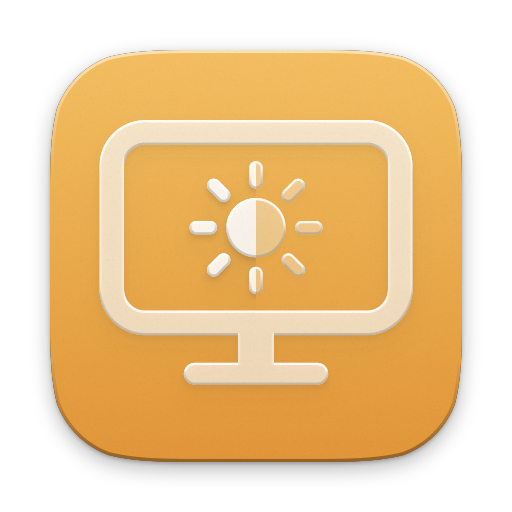
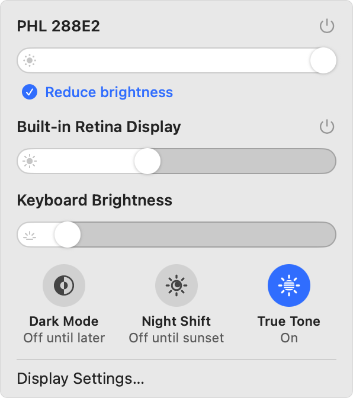
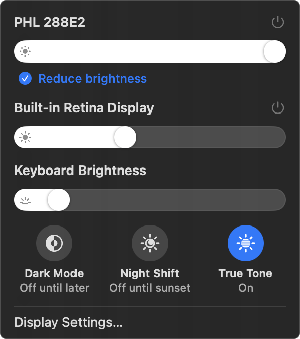

<p align="center">
  
</p>

<h1 align="center">ScreenControl</h1>

<p align="center">
  The macOS Display menu, with the controls it is missing:<br>
  external monitor brightness, dimming below the minimum, turning screens off, and the keyboard backlight.
</p>

<p align="center">
  
  &nbsp;
  
</p>

ScreenControl lives in the menu bar and replaces the system Display menu. It is built to look and behave like Control Center on macOS 15: the same material, metrics, fonts, sliders and buttons. It is not a settings window. It also adds what the system menu can't do:

- **Brightness of external monitors**, over DDC/CI, like the buttons on the monitor.
- **Reduce brightness**: dim a monitor below its lowest hardware setting.
- **Turn a display off and on** without unplugging it. The desktop shrinks to the displays that are still on.
- **Keyboard backlight** slider.

It is a small native app (Swift, AppKit and SwiftUI). It needs no privacy permissions and makes no network connections.

## Features

### Brightness

- One slider per display, external monitors first, then the built-in display.
- The built-in display is set through macOS, as the brightness keys do.
- External monitors are set over DDC/CI.
  - Writes are coalesced while you drag, so a slow monitor never lags behind.
  - A monitor that doesn't answer DDC shows a greyed-out slider, as in the system menu.
- Changes made elsewhere show up while the panel is open: brightness keys, auto-brightness, the monitor's own buttons.

### Reduce brightness

Below each external monitor's slider.

- **On:** the monitor goes to its lowest hardware brightness, and the slider becomes a dimming slider. It starts at 100% (no extra dimming), and the screen gets darker as you move it towards 0.
- **Off:** the dimming is removed and the earlier brightness comes back.
- **The darkest setting** still leaves about 10% of the light, so the screen never goes black and you can always reach the control.
- **Remembered** across restarts.
- **Emergency shortcut:** <kbd>⌃</kbd><kbd>⌥</kbd><kbd>⌘</kbd><kbd>B</kbd> turns it off on every monitor, from anywhere.

### Display power

The power button next to each display's name turns the display off in software.

- **What happens:** the monitor stays connected, but macOS stops using it. Windows move to the displays that are still on.
- **In the panel**, the display stays listed as **Off**, with a green button to turn it back on.
- **Turning off:** the panel settles as soon as you click, the screen fades to black, and then it goes off. While off, its hardware brightness is set to the minimum.
- **Turning on:** the screen stays black through the moment macOS resets its colours, then fades in to its earlier brightness.
- **Never all off:** turning off the last display that is on turns another one on in its place, in the same switch.
- **Persistent:** a display stays off after you quit ScreenControl, and shows as Off when the app opens again.
- **Restored by macOS:** logging out or restarting turns every display back on. If the only display that is on is unplugged, ScreenControl turns the others back on.

### Control Center toggles

- **Dark Mode, Night Shift and True Tone**, with the same round buttons and status lines as Control Center ("Off until sunset", "On until tomorrow"…).
- **Dark Mode** switches like Control Center does: a short pause while apps redraw, then the whole screen cross-fades.
- **Keyboard Brightness**, on Macs with a backlit keyboard.
- **Display Settings…** opens System Settings → Displays.

### Menu bar

- Click the icon to open the panel. Press <kbd>Esc</kbd> or click outside it to close it.
- Right-click the icon for **Launch at Login** (on by default), **Turn Off Reduce Brightness** and **Quit**.

To keep only one Display icon, hide the system one: **System Settings → Control Center → Displays → Don't Show in Menu Bar**.

## Requirements

- macOS 15 Sequoia or later.
- A Mac with Apple silicon, for DDC brightness control. On Intel Macs the rest works, but external brightness does not.
- For external brightness, a monitor with **DDC/CI enabled** in its on-screen menu.
  - Some docks, adapters and HDMI ports don't pass DDC through. On those monitors the brightness slider is greyed out, but Reduce brightness still works.

## Installation

### Download

1. Download `ScreenControl-1.1.dmg` from [Releases](../../releases) and drag ScreenControl to Applications.
2. ScreenControl is not notarized, so macOS blocks it the first time. Open System Settings › Privacy & Security, scroll down and click **Open Anyway**. You can also clear the quarantine flag from Terminal:
   ```sh
   xattr -dr com.apple.quarantine /Applications/ScreenControl.app
   ```

### Build from source

You need the Xcode command line tools (`xcode-select --install`), but not Xcode itself.

```sh
git clone https://github.com/bennhouse/ScreenControl.git
cd ScreenControl
scripts/build-app.sh
```

The script builds a release binary with SwiftPM, assembles `ScreenControl.app`, signs it ad hoc, installs it in `~/Applications` and launches it.

Options:

- `NO_INSTALL=1 scripts/build-app.sh` only builds `build/ScreenControl.app`.
- `UNIVERSAL=1 scripts/build-app.sh` builds for Apple silicon and Intel.
- `scripts/make-dmg.sh` builds the universal installer, `build/ScreenControl-<version>.dmg`, without installing anything.

## How it works

| Feature | How it works |
| --- | --- |
| External brightness | DDC/CI over the display coprocessor's I²C interface (`IOAVService`), VCP code `0x10`. Each monitor is matched to its I²C channel by vendor, model and serial number. |
| Built-in brightness | DisplayServices, the framework behind the brightness keys. |
| Reduce brightness | Scales the display's gamma table. It darkens everything, the cursor included, and doesn't show in screenshots or recordings. |
| Display power | `SLSConfigureDisplayEnabled` in a session-scoped display configuration. |
| Night Shift, True Tone, keyboard backlight | CoreBrightness clients, the ones Control Center uses. |
| Dark Mode | SkyLight's appearance call, plus the system's global preference transition (the cross-fade). |
| Panel material | Rebuilt layer for layer from the window macOS gives `MenuBarExtra` apps: a blurred, saturated backdrop under a grey blend layer. It is calibrated against the Control Center Display menu. |

### Keeping the gamma table in place

macOS resets every display's gamma table in a few situations: when a display is turned on or off, after sleep, and on some colour profile changes. ScreenControl does three things about this:

- **Watchdog:** while dimming is on, it checks every 1.5 seconds and applies the table again.
- **Close guard:** right after a display is reconfigured, a background thread watches the dimmed displays every 2 ms and puts their table straight back. This keeps a dimmed monitor from flashing at full brightness.
- **Off the main thread:** all writes to the window server go through a background queue, so the panel's animations never wait on them.

## Limitations

- **Private interfaces.** Built-in brightness, keyboard backlight, display power, Night Shift, True Tone and Dark Mode use private macOS frameworks.
  - They are looked up when the app starts, so if a future macOS version removes one, that control is disabled instead of crashing the app.
  - Dark Mode falls back to System Events, which asks for permission once.
- **Dimming needs the app running.** It lives in the gamma table, and macOS clears that when the app quits. It comes back when the app starts again, for example at login. Hardware brightness and turned-off displays don't depend on the app.
- **Monitor wake-up time.** After its signal comes back, an external monitor takes its own time to show a picture: usually 1–3 seconds, longer over HDMI because of HDCP. Setting the monitor's input to a fixed source instead of automatic scanning, in its on-screen menu, usually shortens this.
- **Display reconfiguration.** When a display is turned on or off, macOS rearranges the desktop. Some monitors blink briefly while that happens.

## Development

```
Sources/ScreenControl/
  AppDelegate.swift          status item, panel, context menu, login item
  Model/                     displays, keyboard backlight, Control Center toggles
  System/                    DDC, gamma dimming, private APIs, hot key
  UI/                        panel view, controls, glyphs, material, window
scripts/
  build-app.sh               build, sign, install
  make-dmg.sh                universal installer (DMG)
  make-icon.swift            draws the app icon
```

The binary has a few modes for checking the hardware paths from the terminal:

| Command | What it does |
| --- | --- |
| `ScreenControl --selftest` | Checks DDC read and write, gamma dimming, Reduce brightness and the system toggles. Each screen dims for about a second. |
| `ScreenControl --selftest-writes` | Flips Dark Mode, True Tone, Night Shift and the keyboard backlight, and puts each one back. It also checks that dimming survives Night Shift. |
| `ScreenControl --selftest-power` | Turns the built-in display off and on. It checks its brightness and gamma afterwards, and watches a dimmed external monitor for flashes. |
| `ScreenControl --selftest-persist` | Turns the built-in display off, simulates quitting and reopening the app, then turns the display back on. |
| `ScreenControl --snapshot out.png [--dark]` | Renders the panel to an image. |

## Acknowledgements

- [MonitorControl](https://github.com/MonitorControl/MonitorControl) showed how to reach DDC on Apple silicon.
- [This gist by avaidyam](https://gist.github.com/avaidyam/6d0e3605cf85b10f4d0f9d654518e984) showed the animated Dark Mode switch.

## License

[MIT](LICENSE)

ScreenControl is not affiliated with or endorsed by Apple. macOS, Night Shift and True Tone are trademarks of Apple Inc.
